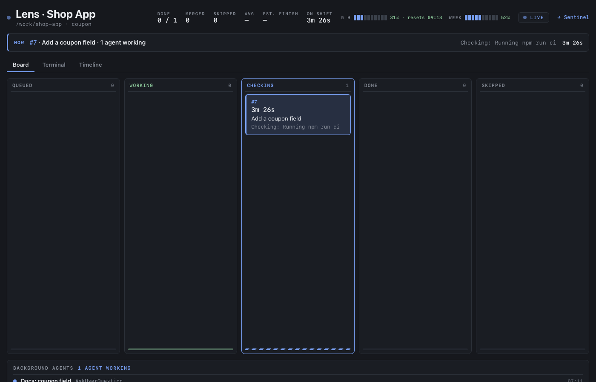

# Lens

A live screen for your Claude Code agents: what they are doing right now, and what they did overnight.



> Status: works day to day: Board, Terminal and Timeline tabs, usage meter, Sentinel link, `GET /agents`, `GET /api/agents`. Not on npm
> yet. See [docs/SPEC.md](docs/SPEC.md).

## Install and run

You need Node 22 or newer.

```bash
git clone https://github.com/Zontak-LLC/nightshift && cd nightshift
npm install && npm run build
npm start
```

Then open http://localhost:4400. The terminal shows the same steps, one line each:

```
21:04:07  demo-app           Editing src/login.ts
21:04:12  demo-app           Running npm test
21:04:31  demo-app           ⇪ pull request #42
```

`curl -N localhost:4400/events` gives the same steps as a live stream (Server-Sent Events).

## What it reads and writes

Lens runs on your own computer. It has no accounts, no server and no telemetry: **nothing leaves your computer.**
- It **reads** Claude Code's logs in `~/.claude/projects`, the usage file `~/.claude/usage-now.json` (if there is one),
  and, if you run it, Sentinel's live stream on `localhost`.
- It **writes** only to `~/.nightshift`: its history (`nightshift.db`) and your project list (`projects.json`).
- The service listens on 127.0.0.1 only and answers only pages on this computer.

## Settings

`NIGHTSHIFT_PORT` (default 4400), `NIGHTSHIFT_LOGS` (default `~/.claude/projects`), `NIGHTSHIFT_DATA` (where the
history is kept, default `~/.nightshift`), `NIGHTSHIFT_KEEP_DAYS` (default 30), `NIGHTSHIFT_USAGE` (the usage file)
and `NIGHTSHIFT_NIGHTWATCH_URL` (Sentinel's address, see below).

The start page shows the git repositories directly under `~/Projects` that Claude worked in during the last 30 days,
and any project that is busy right now. To pin projects, name them, hide one or link a Sentinel site, edit
`~/.nightshift/projects.json` (created empty on the first run):

```json
[
  { "path": "~/Projects/my-app", "name": "My App", "watchSite": "my-app" },
  { "path": "~/Projects/old-thing", "hide": true }
]
```

`name` is what the tile and the board title say (the board address uses the folder name); `hide` removes a repo that
was added by itself; `watchSite` is optional (see below). A damaged file falls back to an empty list and says so in
the log.

## Sentinel link (optional)

Sentinel, our site guard, is optional and not public yet. Lens is the workshop (the coding work); Sentinel is the
guard (the live sites). Without it, Lens works the same and shows no site parts.

Lens only READS Sentinel: it follows `http://localhost:4500/events` (change it with `NIGHTSHIFT_NIGHTWATCH_URL`; only
an address on this computer is accepted), reconnects with a growing wait, and shows "Sentinel: not running" when it is off.
- A project with a watched site shows a **Live site** strip: the site's light (its worst tile), the open incidents, the
  last release and its verdict, and a link `→ Sentinel` to `http://localhost:4500/?site=<id>`.
- Open incidents appear on the Board tab in a **From Sentinel** lane (title, severity, count, age, the AI's
  recommended fix, the issue draft's title). Resolved ones move to **Done · healed** with "healed by ..." when
  Sentinel tried a fix that worked, else "cleared by itself". There are no buttons that act on Sentinel.
- The start page shows a small site light on each linked project's tile, and every page has a `→ Sentinel` link.
- Which project is which site: the `watchSite` of its line in `~/.nightshift/projects.json` (`""` or no `watchSite`
  means no link).

## Usage meter

The header shows two small meters read from `~/.claude/usage-now.json` (change the place with `NIGHTSHIFT_USAGE`),
looked at every 30 seconds: `5 h  31% · resets 06:40` and `Week 52%`, ten segments each, amber from 75% and red from
90%. They turn grey and say "stale" when the file is older than 15 minutes, and they are hidden when the file is
missing. The file is `{"five_hour": 31, "seven_day": 52, "five_hour_resets_at": <unix seconds>, "updated": "<ISO time>"}`.
Times show in the browser's local time.

## History

Lens keeps what it saw in one SQLite file (`~/.nightshift/nightshift.db`). Stop and start it: the board comes back as
it was, each log file is read on from where it stopped (a file that was replaced or cut short is read again from its
top), and no step is shown or stored twice. Sessions that have been quiet for more than 30 days are removed, once an
hour. The file holds your prompts' first lines and tool summaries: it stays on your computer, and the folder is private
to you.

## Background agents

Claude Code runs helpers ("subagents") in the background. Lens follows their logs too
(`<session>/subagents/agent-*.jsonl`, with the name from `agent-*.meta.json`). Each helper is filed under the project
it **really works in**, not the folder its parent session started in: the git repository most of its tool calls touch
(`cd`, `git -C`, file paths). A linked worktree counts as its main repository and is marked "(worktree)". With no
clear repository it stays under its parent's project. The board shows them under the line, the NOW strip says
"3 agents working", the Terminal tab streams their steps tagged with the agent's name, and the Timeline draws a bar
for each. The start page lists projects that only helpers touched.

### Projects

A session is filed by where its steps work, not only by the folder it started in: a session started in `demo-app`
that edits files in `my-app` shows on the `my-app` board too (steps split per repository; a step that names no folder
stays at home). Idle projects stay on the start page, dimmer.

## Run it in the background

```bash
nohup npm start > /tmp/lens.log 2>&1 &    # start (from this folder, after npm run build)
curl -s localhost:4400/health              # {"ok":true,"status":"ok","lastLineAt":"…"}; 503 "stale" when it fell behind
pkill -f "dist/cli.js"                     # stop (it saves its place and closes the file)
```

## Work on it

```bash
npm install
npm run ci                       # everything CI runs: rules, lint, types, tests with coverage
npm run dev                      # the command, restarting on every change
node scripts/demo-board.mjs      # Lens on invented demo data (the screenshot above), in temporary folders
```

- [docs/SPEC.md](docs/SPEC.md): what it is, what is in and out, and the scenarios that prove it.
- [docs/decisions.md](docs/decisions.md): the decision tree, every choice and why.
- [CLAUDE.md](CLAUDE.md): how the code is laid out and the rules it keeps.

## Name

Lens was called Night Shift; the repo, the command and ~/.nightshift keep that name for now.

## Licence

MIT, see [LICENSE](LICENSE).
